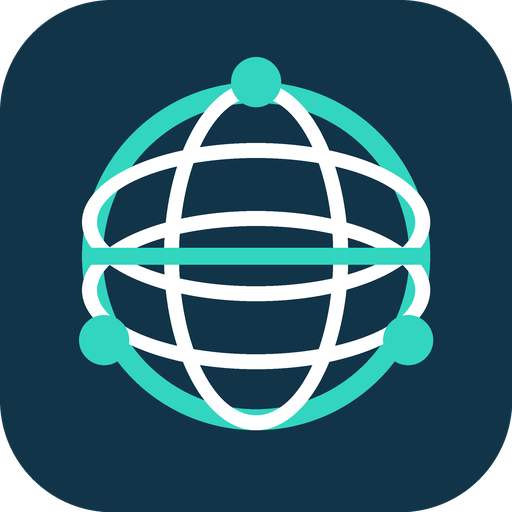

  

<h1 align="center">InterenetBalans</h1>

Личные кабинеты провайдеров Московской области в Home Assistant Нетнорд · Микронмедиа

Интеграция для абонентов интернет-провайдеров **Нетнорд** и **Микронмедиа**
в Московской области. Позволяет видеть баланс, тариф и расходы в Home Assistant,
а также получать напоминания, когда пора пополнить счёт.

Данные берутся из личного кабинета по логину и паролю. Настройка — через
интерфейс Home Assistant, без YAML.

## Поддерживаемые провайдеры

| Провайдер | Личный кабинет | Поддержка |
| --- | --- | --- |
| **Нетнорд / Net-Nord** | [cabinet.net-nord.ru](https://cabinet.net-nord.ru/cabinet/welcome/) | Реализовано |
| **Микронмедиа / Micronmedia** | [app.micmedia.ru](https://app.micmedia.ru/auth) | Планируется |

Сейчас доступен только Нетнорд. Проект независимый и не является официальной
интеграцией провайдеров.

## Сенсоры

| Сенсор | Что показывает |
| --- | --- |
| Баланс | Остаток средств на счёте, ₽ |
| Хватит до | Дата из прогноза провайдера |
| Минимальный платёж | Сумма к пополнению по данным кабинета, ₽ |
| Абонентская плата | Месячная стоимость тарифа, ₽ |
| Расходы за текущий месяц | Сумма списаний по услугам, ₽ |
| Текущий тариф | Название тарифа |
| Стоимость дня | Абонплата, делённая на число дней в месяце, ₽ |
| Осталось дней | Число дней до даты «Хватит до», минимум 0 |
| Пора пополнить | Напоминание о необходимости пополнения |

Данные обновляются раз в час. Оставшиеся дни и напоминание пересчитываются
также в полночь по часовому поясу Home Assistant. Если кабинет не предоставляет
какое-либо поле, соответствующий сенсор показывает неизвестное значение.
Стоимость дня рассчитывается по тарифу без индивидуальных скидок и разовых услуг.

## Установка через HACS

Требуется **Home Assistant 2026.3.0 или новее**.

1. В HACS откройте **⋮ → Пользовательские репозитории / Custom repositories**.
2. Добавьте `https://github.com/EVERYDAYHERO2000/interentrus`, тип **Integration**.
3. Найдите и скачайте **InterenetBalans**.
4. Перезапустите Home Assistant.
5. Откройте **Настройки → Устройства и службы → Добавить интеграцию → InterenetBalans**.
6. Выберите провайдера и введите логин и пароль личного кабинета.

Для ручной установки скопируйте папку `custom_components/isp_balance` в
`/config/custom_components/isp_balance`, перезапустите HA и добавьте интеграцию
через интерфейс.

## Напоминание о пополнении

Откройте **Настройки → Устройства и службы → InterenetBalans → Настроить**
и задайте, за сколько дней напоминать о пополнении. По умолчанию — **3 дня**.

Сенсор «Пора пополнить» включается, если:

- осталось не больше заданного числа дней;
- баланс равен нулю или отрицательный;
- минимальный платёж в кабинете больше нуля.

Для уведомлений создайте автоматизацию с переходом этого сенсора в состояние
`on` и действием отправки уведомления. Интеграция не выполняет платежи
и не изменяет подключённые услуги.

## Учётные данные

Логин и пароль хранятся в конфигурации Home Assistant. При смене пароля
интеграция предложит повторную авторизацию. Не публикуйте учётные данные
и содержимое личного кабинета в сообщениях об ошибках.

[Сообщить о проблеме](https://github.com/EVERYDAYHERO2000/interentrus/issues/new/choose)
